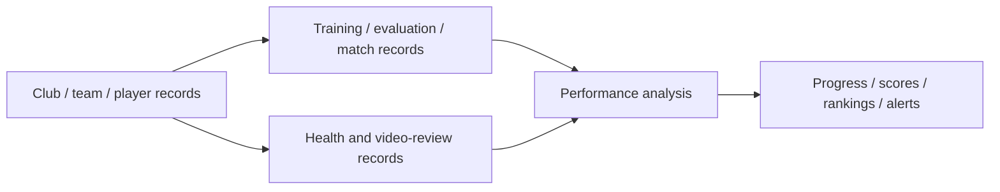

# Player Performance

**Focus:** Sports management / Performance analysis

**My role:** Built the project on EspoCRM

**Scope:** MVP with live users

## Overview

Built a PHP/EspoCRM sports management MVP with custom JavaScript interfaces for player development, training, health, and performance analysis.

## Business problem

Give clubs and academies one place to manage players and assess development across training, matches, and health records.

## My contribution

Built the MVP on EspoCRM using a PHP backend and custom JavaScript interface components.

## Technology stack

PHP, EspoCRM, JavaScript.

## Platform capabilities

- Organizations, teams, players, coaches, and staff
- Physical measurements, fitness tests, technical/mental evaluations, and match statistics
- Training sessions, attendance, assigned tasks, and completion tracking
- Wellness, injuries, rehabilitation plans, and recovery sessions
- Video review, comments, and timeline tags
- Weighted scores, progress trends, rankings, recommendations, and alerts

## Conceptual architecture

Club and player records connect with training, evaluation, match, health, and video-review records. Analysis surfaces scores, progress, rankings, recommendations, and alerts.

This diagram summarizes the supplied system description; it is not a reverse-engineered code dependency graph.

## Scope notes

- Retain the MVP label. FFmpeg processing and external storage integrations were disabled and must not be claimed as enabled features.
- This is a documentation case study. The original application source code and a public demo are not provided here.

[Back to all case studies](../../README.md)
