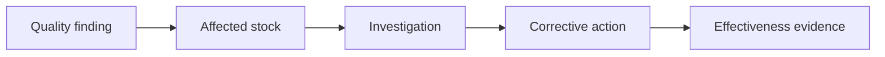

# QOREVA

**Focus:** Quality management / Workflow automation

**My role:** Built the project on EspoCRM

**Scope:** Professional project with live users; separate sample-data demonstrations

## Overview

Built an EspoCRM-based quality management system connecting inspections, investigations, corrective actions, evidence, and dashboards.

## Business problem

Keep quality findings, affected stock, investigations, corrective actions, and effectiveness evidence connected through issue resolution.

## My contribution

Built QOREVA on EspoCRM, bringing the supplied quality workflows, linked records, approvals, evidence, and dashboards into one workspace.

## Technology stack

EspoCRM, Linked records, Approval workflows, Document versioning, Dashboards.

## Platform capabilities

- Receiving, production, cleaning, packaging, and batch inspections
- Nonconformances, root-cause investigations, and corrective and preventive actions (CAPA)
- Audits, risks, equipment calibration, maintenance, and training
- Supporting PDFs, document versions, and approval workflows
- Quality indicators, trends, overdue work, and access to underlying records
- Separate company-specific demonstration environments using sample records and documents

## Conceptual architecture

Quality finding -> affected stock -> investigation -> corrective action -> effectiveness evidence. Linked documents and approvals support traceability across the workflow.

This diagram summarizes the supplied system description; it is not a reverse-engineered code dependency graph.

## Scope notes

- Demonstration data does not establish actual company incidents or customer adoption. Do not present Breadway or Frida as verified customers.
- This is a documentation case study. The original application source code and a public demo are not provided here.

[Back to all case studies](../../README.md)
