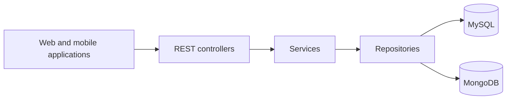

# Sareb Backend

**Focus:** Fleet management / Java backend

**My role:** Backend Contributor

**Scope:** Professional project with live users

## Overview

Contributed to an existing Java 11/Spring Boot fleet management backend providing APIs for vehicle operations and business applications.

## Business problem

Connect fleet records, tracking devices, operational resources, and application workflows through a backend API.

## My contribution

Contributed to the existing backend. The platform capabilities below describe the system's scope and are not claims of sole authorship.

## Technology stack

Java 11, Spring Boot 2.7.2, MySQL, MongoDB, JWT, Maven, Swagger.

## Platform capabilities

- REST APIs for vehicles, drivers, tracking devices, collectors, and warehouses
- Controller-service-repository application structure
- MySQL and MongoDB persistence with Redis also configured
- JWT authentication
- ELM integration and driver mobile app APIs
- Reports, dashboards, and notifications

## Conceptual architecture

Applications call REST controllers, which delegate to services and repositories backed by MySQL and MongoDB. Redis is configured; a specific caching implementation is not established.

This diagram summarizes the supplied system description; it is not a reverse-engineered code dependency graph.

## Scope notes

- Redis should be described as configured, not as a personally implemented caching solution.
- This is a documentation case study. The original application source code and a public demo are not provided here.

[Back to all case studies](../../README.md)
