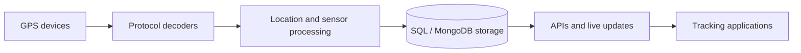

# Sareb GPS Tracking Backend

**Focus:** GPS / IoT / Java backend

**My role:** Backend Contributor

**Scope:** Professional project with live users

## Overview

Contributed to an existing Java 21/Traccar tracking server that processes GPS device messages into vehicle data, stored records, APIs, and live updates.

## Business problem

Receive tracking-device data, process positions and sensor readings, and expose vehicle activity to applications.

## My contribution

Contributed to the existing Traccar-based backend rather than building the platform from scratch. The following capabilities describe the platform.

## Technology stack

Java 21, Traccar, Netty, Jetty, Jersey, Guice, Gradle, SQL storage, MongoDB.

## Platform capabilities

- Device connections, protocol decoding, and location processing
- Live vehicle location, movement, speed, and connection status
- Devices, drivers, users, groups, and maintenance
- Geofences, fuel, engine hours, alarms, and notifications
- Trip, event, and vehicle activity reporting
- Custom MongoDB integration, device error monitoring, and transport-specific location handling

## Conceptual architecture

GPS device -> protocol decoder -> location processing -> database -> APIs and live updates. The stack uses Netty for device connections, Jetty/Jersey for web APIs, and Guice for dependency injection.

This diagram summarizes the supplied system description; it is not a reverse-engineered code dependency graph.

## Scope notes

- Do not attribute every custom feature or upstream Traccar capability to personal authorship.
- This is a documentation case study. The original application source code and a public demo are not provided here.

[Back to all case studies](../../README.md)
