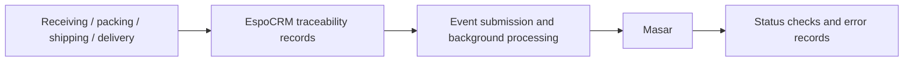

# Track & Trace APIs

**Focus:** Pharmaceutical traceability / API integration

**My role:** Built the project on EspoCRM

**Scope:** Professional project with live users

## Overview

Built a PHP/EspoCRM pharmaceutical traceability backend with Masar/EPCIS integration and background request processing.

## Business problem

Track medicines through receiving, packing, shipping, and delivery and synchronize supply-chain activities with Masar.

## My contribution

Built the project on EspoCRM, including the supplied pharmaceutical workflows and Masar integration. This does not imply authorship of the EspoCRM framework.

## Technology stack

PHP, EspoCRM, Masar integration, EPCIS, Background processing.

## Platform capabilities

- Medicine catalog and item identification by GTIN, serial number, batch, and expiry date
- Box identification using SSCC codes
- Inventory records for items, boxes, branches, and accounts
- Receiving, packing, shipping, and delivery workflows
- EPCIS commissioning, aggregation, and transfer event submission to Masar
- Background request processing, status checks, and integration error recording
- Administration through EspoCRM permissions, workflows, and reporting

## Conceptual architecture

Receiving and shipping operations produce traceability records and EPCIS submissions. Background processing sends requests to Masar, checks processing status, and records integration errors.

This diagram summarizes the supplied system description; it is not a reverse-engineered code dependency graph.

## Scope notes

- No unverified certification, regulatory-compliance claim, event count, or partner adoption claim is supplied.
- This is a documentation case study. The original application source code and a public demo are not provided here.

[Back to all case studies](../../README.md)
